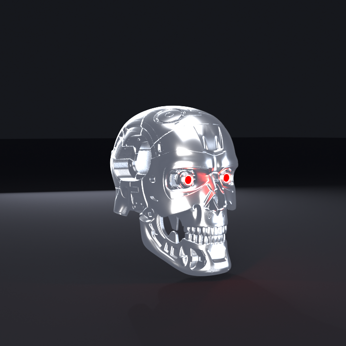

# Robot (styl T-800) z Claude jako mózgiem

<p align="center"></p>

**EN:** A T-800 style robot head with Claude as its brain. Every motor command goes through a safety supervisor
(joint limits, max step, e-stop that only a human can release). Runs today against a MuJoCo simulation; next step is
a camera + mic + speaker board (ESP32-S3) talking to a voice/vision server on the PC, then a 3D-printed skull.
Code and docs are in Polish.

**PL:** Etap 0, dzień 1: **wirtualny robot (głowa) + pętla Claude z narzędziami + nadzorca bezpieczeństwa**, bez sprzętu.
Pełny plan: `docs/PLAN_BUDOWY.md`. Narzędzia i wtyczki: `docs/NARZEDZIA.md`.

## Uruchomienie

Wymagany Python 3.11+ (zalecany 3.12; systemowy 3.14 jest za nowy dla bibliotek ML).

Środowisko jest już zainstalowane w `C:\Users\Jeff\.venvs\robot` (lista pakietów: `requirements-lock.txt`).

```bash
C:\Users\Jeff\.venvs\robot\Scripts\activate

python -m pytest -q                      # testy (21)
python -m brain.main                     # rozmowa w terminalu (tryb demo bez klucza)
set ANTHROPIC_API_KEY=...                # prawdziwy Claude (ustaw limit wydatków w koncie API)
```

Odtworzenie środowiska od zera: `py -3.12 -m venv <ścieżka>` i `pip install -r requirements-lock.txt`.

Z kluczem `ANTHROPIC_API_KEY` i pakietem `anthropic` mózgiem jest Claude (model z `ROBOT_MODEL`,
domyślnie `claude-haiku-5-5`, ok. 20x taniej od Sonneta; do trudniejszych zadań `ROBOT_MODEL=claude-sonnet-5-5`). Ustaw limit wydatków w koncie API. Bez klucza działa tryb demo.

Komendy w terminalu: `/stan`, `/odblokuj` (zdejmuje e-stop, tylko człowiek), `/koniec`.

## Struktura

```
brain/       pętla Claude (agent.py), narzędzia (tools.py), nadzorca (safety.py), interfejs robota (robot_iface.py)
sim/         model MuJoCo głowy (head.xml) i jego implementacja interfejsu (mujoco_robot.py)
tests/       testy jednostkowe (unittest, bez sieci)
docs/        plan budowy i lista narzędzi
```

## Zasady bezpieczeństwa (w kodzie)

- Claude nigdy nie steruje silnikami wprost: każde narzędzie przechodzi przez `Supervisor` (limity kątów, maks. skok, e-stop).
- Claude może wywołać `emergency_stop`, **odblokować może tylko człowiek** (`/odblokuj`).
- Odrzucone polecenie wraca do modelu jako błąd z wyjaśnieniem, robot się nie rusza.

## Dalsze kroki (z planu)

1. ~~Prawdziwy klucz API i test rozmowy~~ (gotowe: `claude-haiku-5-5` przechodzi 10 scenariuszy bezpieczeństwa).
2. Serwer na PC: rozpoznawanie mowy, synteza mowy i opis sceny z kamery, testowany najpierw na kamerce i mikrofonie PC.
3. Płytka DFRobot ESP32-S3 AI Camera (DFR1154) w głowie jako oczy, uszy i głośnik.
4. Wydruk czaszki T-800 (model z MakerWorld, skala 115%) i ruch szyi w kolejnych etapach.

## Licencja

Kod i dokumentacja: MIT (plik `LICENSE`). Geometria czaszki **nie jest w repozytorium**: to model
"T-800 Head for a1mini" (BumblebeeGTR, remiks modelu senfsaft) na licencji CC BY-NC-SA, pobierany z MakerWorld
(szczegóły i linki: `cad/t800/README.md`). Rendery tego modelu udostępniam na tej samej licencji CC BY-NC-SA.
